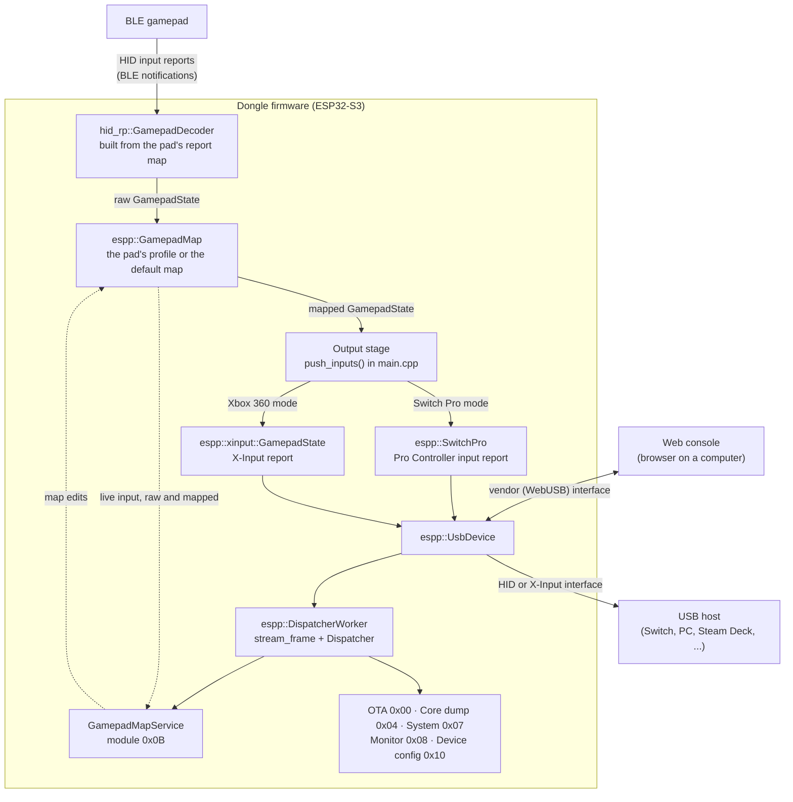
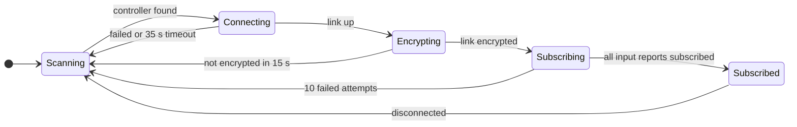

# Architecture

This page explains how the firmware turns a Bluetooth LE gamepad's reports into a wired Switch Pro or Xbox 360 controller, how the web console talks to it, where each piece lives in the source, and which [espp](https://github.com/esp-cpp/espp) components it is built from. It is written for developers. For building and flashing, see [Building from source](building.md).

## How it works

1. **The dongle connects to the controller as a BLE central.** Before it subscribes to the controller's inputs, it reads the controller's HID Report Map, its PnP ID (vendor and product ID) and its name.
2. **The report map becomes a decoder.** espp's `hid_rp::GamepadDecoder` turns each input report into an `espp::GamepadState`. Buttons in that state are named by position (South, East, West, North, ...), and the sticks and triggers are normalized.
3. **A button map rewrites the state.** The dongle applies the controller's profile, found by its BLE VID:PID, or the default map. Maps live in a file and are edited from the web console.
4. **The output stage writes one USB report.** In Switch Pro mode that is an `espp::SwitchPro` input report. In Xbox 360 mode it is an `espp::xinput::GamepadState`.
5. **`espp::UsbDevice` sends the report** on the HID or X-Input interface. The same device also carries a vendor (WebUSB) interface, which brings the web console's requests to the dispatcher modules.

## Source map

| Path | Role |
|---|---|
| `main/main.cpp` | `app_main`: board, LED and screen setup, services, the 3 s pairing button, the per-controller decoder and map, the output stage (Switch Pro report or X-Input state), the L+R registration window, the 1 s status loop and the debug switches. |
| `main/ble.cpp`, `main/ble.hpp` | The BLE central on NimBLE (through esp-nimble-cpp): scanning, pairing and bonding, the 100 ms link supervisor (which also owns the LED), HID subscription, the battery level, bond management and link diagnostics. |
| `main/usb.cpp`, `main/usb.hpp` | The composite `espp::UsbDevice` for the selected USB type. It contains the sender task (Pro Controller handshake replies, the 8 ms input report, X-Input submission, USB pull-up re-arm) and the `espp::DispatcherWorker` that serves the vendor stream. |
| `main/services.cpp`, `main/services.hpp` | Settings and controller names in NVS, the button maps (`espp::GamepadProfiles` on LittleFS) with the v3 migration, and the registration of the six console modules and discovery. |
| `main/status_led.hpp` | LED brightness, the per-state levels, and the steady and blink helpers. Every LED write goes through it. |
| `main/bsp.hpp`, `main/generic_s3.hpp` | Board selection (the `Bsp` alias, `HARDWARE_NAME`, `HAS_DISPLAY`) and the generic ESP32-S3 board support. |
| `main/Kconfig.projbuild`, `main/idf_component.yml` | Build options (see [Configuration options](building.md#configuration-options)) and registry dependencies. |
| `components/device_config` | The dongle's own console module: a dependency-free protocol header, the `DeviceConfig` module class and a host test. |
| `components/gamepad_inputs` | `GamepadInputs`: the output stage's button bitfield, with aliases for the generic, Xbox and Switch Pro layouts, plus float sticks and triggers. |
| `components/gui` | The T-Dongle-S3 status screen (LVGL). `squareline/` holds the SquareLine Studio project and `generated/` holds its exported code. |
| `web/dongle_console.html`, `web/esptool-bundle.js`, `web/test/` | The browser console, the vendored esptool-js used by its Full update, and the console's node test. See the [console protocol notes](../web/README.md). |
| `partitions.csv`, `sdkconfig.defaults`, `sdkconfig.defaults.generic_s3` | The flash layout, the build defaults and the generic-board overlay. |
| `.github/workflows/` | Build, static analysis, release packaging and the GitHub Pages publish (see [What CI runs](building.md#what-ci-runs)). |

## Tasks and timing

| Task or timer | Where | Runs | Job |
|---|---|---|---|
| NimBLE host task | NimBLE (6 KB stack) | on each notification | Decodes the report, applies the map, publishes live input and pushes the result to the output stage. Also stores battery-level notifications. |
| `Scan Timer` (link supervisor) | `main/ble.cpp` | every 100 ms (8 KB stack) | Restarts scans, re-requests security, subscribes to the HID reports, notices missed disconnects and owns the LED. |
| `breathe` | `main/ble.cpp` | every 10 ms, only while nothing is connected | The breathing LED. |
| `ble_rumble` | `main/ble.cpp` | wakes on a queued output report (4 KB stack) | Writes the latest queued HID output report (rumble) to the controller, off the TinyUSB / NimBLE host tasks. |
| `usb_hid_tx` | `main/usb.cpp` | wakes on demand or every 8 ms (priority 10) | Sends the Pro Controller handshake replies and its input report stream, submits and retries X-Input reports, and re-arms the USB pull-up. |
| `usb_rx` (DispatcherWorker) | `main/usb.cpp` | on vendor bytes (8 KB stack) | Parses frames and runs every console module's handler and replies, away from the TinyUSB task. |
| `usb-reg` | `main/main.cpp` | every 50 ms | Holds L+R for 1 s after the Switch finishes the handshake (Switch Pro mode only). |
| Main task loop | `main/main.cpp` | every 1 s | Updates the screen and reads the connected controller's serial number. |
| `Gui Task` | `components/gui` | every 16 ms (T-Dongle-S3 only) | Runs the LVGL handler. |
| `Pairing Timer` | `main/main.cpp` | one shot, 3 s after a button press | Starts pairing. Releasing the button cancels it. |

Nothing that waits runs on the TinyUSB task. Pro Controller handshake replies are worked out there, but they are queued (at most 16) and sent by `usb_hid_tx`. Vendor bytes are only queued there, for `usb_rx`.

**Latency.** The BLE connection uses a 15 ms interval, a peripheral latency of 4 and a 4 s supervision timeout. A report is decoded and mapped when its notification arrives. In Switch Pro mode the latest report goes out every 8 ms, the real Pro Controller's polling interval. In Xbox 360 mode a new state is submitted as soon as it changes (the X-Input IN endpoint polls every 4 ms).

## The Bluetooth side

**Scanning.** Active scanning with a 30 ms window every 300 ms (10 % duty cycle). Each scan runs for 5 s, and the supervisor starts the next one only after the previous one has fully stopped. It waits 500 ms because restarting while the NimBLE host task is still draining scan results can crash esp-nimble-cpp.

**Which devices it connects to.** While pairing, the dongle connects to the first device that advertises the HID service or the gamepad appearance. Otherwise it connects only to bonded devices. Pairing lasts 30 s after the button or the console's *Start pairing*, and continues as long as nothing is bonded. Once a connection starts, the scan stops, so the dongle handles one controller at a time.

**Security.** Bonding with LE Secure Connections, no MITM protection, and IO capability *NoInputNoOutput* ("Just Works"). Bonds are stored in NVS (`CONFIG_BT_NIMBLE_MAX_BONDS=5`).

**Bring-up.** The link supervisor drives every step from one place, whichever BLE callback did or did not fire:

- **Encrypting.** The dongle polls the connection for encryption and asks for security again every 3 s. After 15 s it disconnects.
- **Subscribing.** The dongle tries about every 500 ms. It reads the controller info, then subscribes to every HID Report characteristic whose Report Reference (`0x2908`) says *input*. This is all or nothing: if any input report fails, the attempt is discarded and retried. After 10 failed attempts it disconnects but keeps the bond.
- **Subscribed.** The dongle also subscribes to the Battery Service level, if the controller has one, and stores the controller's name (its GAP Device Name, or else its advertised name, at most 31 characters) for the console's paired-controller list.

The states and the dongle's note on the last link event are what the console's Link block shows (`device_config::Info::link_state` and `link_detail`). The values are part of the protocol, so they must not be renumbered. When the link goes down, the dongle releases every button and centres the sticks at once, so nothing stays pressed on the host.

**Forgetting bonds.** NimBLE refuses to delete a bond while a scan is running. `ScanHold` stops the scan and holds the scan mutex until the deletion is done, so no other path can restart the scan in between.

## Decoding and mapping

`make_decoder()` in `main/main.cpp` builds a `hid_rp::GamepadDecoder` from the controller's report map. If the map cannot be read or parsed, or `GamepadDecoder::looks_like_gamepad()` rejects it, the decoder falls back to the Xbox Wireless Controller's descriptor (`espp::xbox_descriptor()`), which is how every controller was decoded before v4. It then applies espp's per-VID/PID quirks (`apply_quirks()`) and turns off combined controls, so every control reports only itself and the button map does the rest. A controller can notify several input reports. The decoder keeps the latest report of each ID and decodes them together.

The decoder and the active map are guarded by one mutex. They are replaced on connect (from the scan-timer task) and on a map edit (from the console worker), while reports are decoded on the NimBLE host task. Each report is decoded, mapped (`GamepadMap::apply`), published to the console's live view, and handed to the output stage. How profiles and rules work for users is covered in the [button mapping guide](button-mapping.md).

**The output stage** (`to_inputs()` and `push_inputs()`) maps the mapped state to the USB report:

| Mapped `GamepadState` | Switch Pro Controller | Xbox 360 (X-Input) |
|---|---|---|
| South / East / West / North | A / B / X / Y | A / B / X / Y |
| L1 / R1 | L / R | LB / RB |
| Left / Right trigger axis | ZL / ZR, pressed above 50 % | LT / RT, 0–255 |
| L2 / R2 buttons | ZL / ZR (OR-ed with the axis) | LT / RT at 255 while pressed |
| L3 / R3 | stick clicks | LS / RS |
| D-pad | D-pad | D-pad |
| Start / Select | + / − | Start / Back |
| Home | Home | Guide |
| Capture | Capture | not sent |
| Sticks | Y flipped to up-positive | 16-bit, Y flipped to up-positive |
| Battery level | sent in the Pro Controller report | – |

South is sent as the host's A. Pressing the bottom face button (Xbox A) therefore sends the Switch's A, even though a Nintendo controller has A on the right. To match Nintendo's positions instead, swap South and East with the Nintendo A/B preset (see [Recipes](button-mapping.md#recipes)). A trigger is pulled by its axis or by its L2 / R2 button, so on/off triggers need no rule ([Triggers](button-mapping.md#triggers)). For what is and is not forwarded from the controller (rumble, motion), see [What is forwarded](controllers.md#what-is-forwarded).

## The USB side

`start_usb()` builds one `espp::UsbDevice` for the USB type the settings chose at boot. USB descriptors are fixed when the device enumerates, so a type change takes effect at the next boot.

| USB type | Vendor interface on (default) | Vendor interface off |
|---|---|---|
| Switch Pro | `057E:2009`: Pro Controller HID + vendor (WebUSB) [+ CDC] | `057E:2009`: Pro Controller HID [+ CDC] |
| Xbox 360 | `045E:0E60` (`CONFIG_DONGLE_USB_XBOX_PID`): X-Input + vendor (WebUSB) [+ CDC] | `045E:028E` (retail identity): X-Input alone |

`[+ CDC]` is the optional log port (`CONFIG_DONGLE_USB_CDC_CONSOLE`). In every mode, the USB serial number is 12 hex digits derived from the chip's MAC address, so hosts and the console can tell dongles apart.

### Pro Controller fidelity

The Switch compares the device with a real Pro Controller, so `espp::SwitchPro` supplies one set of values for the descriptors and the protocol:

- **Identity:** vendor `0x057E`, product `0x2009`, manufacturer "Nintendo Co., Ltd.", product "Pro Controller", device release (`bcdDevice`) 2.10, 500 mA bus power, remote wakeup advertised. A Switch binds the controller only with Nintendo's identity.
- **Interface:** one HID interface with an OUT endpoint, for the host's output reports, which carry the handshake. It polls at 8 ms.
- **Handshake:** on mount the dongle sends the device-init report (`0x81`) without waiting to be asked. `espp::SwitchPro::on_hid_report()` answers each host output report, and `usb_hid_tx` sends the reply, retrying for up to 20 ms while the endpoint is busy.
- **Input stream:** once the host has enabled reports (`is_ready()`), the latest input report goes out every 8 ms. The console's USB output counters (`usb_hid_ready`, `usb_hid_reports`) come from here.
- **One controller per dongle:** `espp::SwitchPro` reports the chip's factory MAC as the controller's Bluetooth address, so two dongles on one Switch are two different controllers (see [Nintendo Switch](hosts.md#nintendo-switch)).
- **Change Grip/Order:** the `usb-reg` timer holds L+R for 1 s after each handshake completes, so the dongle registers on that screen with no hand on the controller.
- **Pull-up re-arm:** if the host drops a configured link and does not enumerate the dongle again, `usb_hid_tx` drops and restores the D+ pull-up (`tud_disconnect()`, 20 ms, `tud_connect()`) every 2.5 s until the host does. It never does this before the first mount, so a slow first enumeration is not interrupted.

### The Xbox 360 identity

In Xbox 360 mode the dongle stays a composite device, so the console keeps working. Getting both Windows and Linux to bind the X-Input interface takes three choices:

- **Microsoft's vendor ID (`0x045E`) with a product ID of its own** (`CONFIG_DONGLE_USB_XBOX_PID`, default `0x0E60`). Windows' Xbox 360 driver INF lists the retail controllers' product IDs (`0x028E`, `0x0719`, ...). A match on those would take the whole device and hide the console interface. With its own product ID, Windows splits the composite device instead. Microsoft's vendor ID is what lets Linux's xpad driver recognize the X-Input interface.
- **An MS OS 2.0 descriptor** from `espp::UsbDevice` that gives the X-Input interface the compatible ID `XUSB10`, which Windows' own Xbox 360 driver binds to. The vendor interface gets `WinUSB` in the same descriptor set, which is why WebUSB needs no driver on Windows.
- **Descriptor values:** manufacturer "esp-usb-ble-hid", product "Xbox 360 Controller", device release `0x0114`, 500 mA, no remote wakeup. The X-Input interface sends 20-byte input reports.

The MS OS 2.0 descriptor comes with the vendor interface. A build without it (`CONFIG_DONGLE_USB_VENDOR_INTERFACE=n`) therefore presents X-Input alone with the retail identity `045E:028E` and the Xbox controller's `0xFF/0xFF/0xFF` device class, which binds everywhere. The CDC port is left out in that mode, because a composite device with neither the retail identity nor the `XUSB10` ID would bind nothing on Windows.

Other details:

- **Rumble reports from the host drive the Xbox Wireless controller's motors.** The two motor levels are decoded on the TinyUSB task and queued (`ble_queue_output_report()`); the `ble_rumble` task does the BLE write of the controller's rumble output report (id 3, the xpadneo layout). Only the latest queued report is sent, and a queued report never survives a disconnect. Other controllers' rumble layouts are not known, so their motors are not driven. The LED part of the report is ignored.
- **Reports are sent on change.** The sender keeps the latest state and retries it every 8 ms until the endpoint takes it, so a button release, or the neutral state after a disconnect, is never lost. After a remount it sends the current state again.
- **Detecting a host with no X-Input driver.** If a report stays in flight for more than 250 ms, nobody is reading the interface. `usb_hid_ready()` then reports false, and the console's Device tab says the host is not reading X-Input reports. On a Mac this is expected.
- **The console must know the identity.** `web/dongle_console.html` lists `045E:0E60` next to `057E:2009` in `DONGLE_IDS`. Keep the two in step if you change the product ID.

These are Microsoft's and Nintendo's identifiers. Use them only to emulate your own device.

## The console link

The vendor interface is an `espp::UsbDevice` vendor function with WebUSB enabled. It provides the BOS and WebUSB descriptors, the MS OS 2.0 descriptor described above, and the landing page `finger563.github.io/esp-usb-ble-hid/dongle_console.html`. The stream on it is espp `stream_frame`: `[magic 0x4F54][flags][module][type][len u32][payload][crc32]`, little-endian, with an optional correlation field. An `espp::Dispatcher` routes frames by module id.

- **Off the TinyUSB task.** Received bytes are queued (bounded) for the `usb_rx` worker, which parses frames and runs the module handlers and their replies. If the queue overflows, the parser resynchronizes and the OTA service aborts any update in flight. A mount or unmount also resets the parser.
- **One writer at a time.** Replies come from the worker, but the monitor service streams from its own task. A mutex keeps their frames from interleaving.
- **Discovery.** `serve_discovery("ESP USB BLE HID", <firmware version>)` answers on the reserved discovery module (`0xFF`; ids `0xF0`–`0xFF` are reserved). Each module advertises a protocol id, and the console finds its tabs by protocol id first, falling back to the module id.

### Console modules

| Module | Id | Discovery protocol | Provided by | Console tab |
|---|---|---|---|---|
| OTA | `0x00` | `espp.ota` | `espp::OtaService` (`espp/ota`) | Firmware |
| Core dump | `0x04` | `espp.coredump` | `espp::CoreDumpService` (`espp/coredump`) | Crash dump |
| System | `0x07` | `espp.system` | `espp::SystemService` (`espp/system`): info, reboot, reboot into the ROM bootloader | System |
| Monitor | `0x08` | `espp.monitor` | `espp::MonitorService` (`espp/monitor`): heap regions and the task table | System (Memory) |
| Gamepad map | `0x0B` | `espp.gamepad_map` | `espp::GamepadMapService` (`espp/gamepad_map`): the default map and per-controller profiles, plus live input | Button mapping |
| Device config | `0x10` | `esp-usb-ble-hid.device-config` | `DeviceConfig` (`components/device_config`, this repository) | Device, Settings |

Each module is registered with one `register_module()` call in `services_init()`. The five espp modules speak protocols shared with espp's own tools. That is why, for example, espp's Gamepad Map Console can edit the dongle's maps. What each tab does for users is covered in the [web console guide](web-console.md). The console's side of the protocol is described in the [console protocol notes](../web/README.md).

## Storage

### Flash layout

`partitions.csv` on a 4 MB flash:

| Partition | Type | Offset | Size | Holds |
|---|---|---|---|---|
| (bootloader) | – | `0x0` | – | Second-stage bootloader, with app rollback enabled |
| (partition table) | – | `0x8000` | – | This table |
| `nvs` | data / nvs | `0x9000` | 24 KB | Settings, controller names, BLE bonds and RF calibration data |
| `otadata` | data / ota | `0xF000` | 8 KB | Which app slot boots, and its rollback state |
| `phy_init` | data / phy | `0x11000` | 4 KB | Reserved for PHY init data (unused: this build compiles the PHY data into the app and keeps RF calibration in NVS) |
| `ota_0` | app | `0x20000` | 1856 KB (`0x1D0000`) | App slot A |
| `ota_1` | app | `0x1F0000` | 1856 KB (`0x1D0000`) | App slot B |
| `coredump` | data / coredump | `0x3C0000` | 128 KB | The last crash's core dump (ELF) |
| `littlefs` | data / littlefs | `0x3E0000` | 128 KB | `gamepad_profiles.bin`: the button maps |

v4 split v3's 256 KB core-dump partition into `coredump` and `littlefs`. NVS stayed where it always was, so pairings and settings survive the move. An OTA update cannot change the partition table, which is why moving from v3 to v4 takes one [Full update](updating.md#full-update). A v4 image installed over OTA onto a v3 table finds no `littlefs` partition. It then keeps the maps in RAM only and sets the INFO flag `needs_full_flash`, and the console offers the Full update.

### What is stored where

| Store | Key | Contents |
|---|---|---|
| NVS namespace `dongle` | `usb_ctl` | USB controller type: 0 = Switch Pro, 1 = Xbox 360 |
| | `led`, `led_conn`, `led_recon`, `led_pair`, `led_blink` | LED brightness, the connected, reconnecting and pairing levels, and the per-input blink |
| | `ble_name` | The dongle's own BLE device name (default `Switch`), applied at boot |
| | `inv_ly`, `inv_ry`, `swap_ab`, `swap_xy`, `deadzone` | v3's input settings, kept so the first v4 boot can turn them into the default map |
| NVS namespace `bondnames` | the bond's address as 12 hex digits | The controller's name, as shown in the console |
| NimBLE's NVS store | – | The bonds themselves (keys and addresses) |
| `littlefs` | `gamepad_profiles.bin` | The default map and up to 16 controller profiles (`espp::GamepadProfiles`) |
| `coredump` | – | The panic core dump, summarized in the log at the next boot |

Settings changes go through the `DeviceConfig` module. A `SET_SETTINGS` request can be partial. The module validates the merged result, and the app stages every key on one NVS handle and commits once. Only when that commit succeeds are the new values applied and adopted. A failed save leaves the old values running, so the running settings always match what the next boot will load. LED changes apply at once, while the USB type and the BLE name apply at the next boot. If stored values ever fail validation at boot, the whole set falls back to the build's defaults.

## Built with espp

The dongle doubles as a worked example of espp's USB, HID, gamepad and web-console components. The version floors come from `main/idf_component.yml`. `dependencies.lock` pins the exact versions CI builds, which today are a mix of espp 1.4.2 and 1.4.6.

| Component | Needs | What the dongle uses it for |
|---|---|---|
| `espp/usb_device` | ≥ 1.4.2 | `espp::UsbDevice`: the composite device with `HidFunction` (Pro Controller), `XInputFunction` (X-Input + `XUSB10`), `VendorFunction` (WebUSB, MS OS 2.0, landing page) and `CdcFunction` (log console), on `esp_tinyusb`. In `main/usb.cpp`. |
| `espp/switch_pro` | ≥ 1.4.2 | `espp::SwitchPro`: the Pro Controller's identity, report descriptor, handshake replies and input report. |
| `espp/hid-rp` | ≥ 1.4.6 | `hid_rp::ReportMap` and `GamepadDecoder`: decoding any controller from its report map, the Xbox descriptor fallback, the per-controller quirks, and the Switch Pro report layout. |
| `espp/gamepad_map` | ≥ 1.4.6 | `GamepadState`, `GamepadMap` (rules and dead zones), `GamepadProfiles` (maps in a file) and `GamepadMapService` (module `0x0B`). |
| `espp/stream_frame`, `espp/dispatcher` | ≥ 1.4.2 | The console stream's framing and module routing. `DispatcherWorker` runs the handlers on their own task. |
| `espp/ota` | ≥ 1.4.2 | `espp::Ota` (two slots, rollback), `OtaService` (module `0x00`), and the `idf.py ota-usb` / `espp-ota` host tool. |
| `espp/coredump` | ≥ 1.4.2 | `CoreDump` (reads the stored dump and formats the boot summary) and `CoreDumpService` (module `0x04`). |
| `espp/system`, `espp/monitor` | ≥ 1.4.2 | `SystemService` (module `0x07`) and `MonitorService` (module `0x08`). |
| `espp/nvs`, `espp/file_system` | ≥ 1.4.2 | Settings and controller names in NVS, and mounting the `littlefs` partition. |
| `espp/hid_service`, `espp/ble_gatt_server` | ≥ 1.4.2 | The BLE UUIDs and constants for the HID, Battery, Device Information and GAP services and the gamepad appearance. `ble_gatt_server` also brings in esp-nimble-cpp. |
| `espp/t-dongle-s3`, `espp/qtpy` | ≥ 1.4.2 | Board support: the LED, the button, and the T-Dongle-S3's LCD and LVGL display. |
| `espp/logger`, `format`, `color`, `math`, `task`, `timer` | ≥ 1.4.2 | Logging, HSV colours for the LED, the Gaussian breathing curve, and the tasks and timers. |

Other dependencies: `espressif/esp_tinyusb` (≥ 2.0; the lock resolves 3.0.1), `h2zero/esp-nimble-cpp` (2.6.0, through espp), `joltwallet/littlefs` (through `espp/file_system`) and `lvgl/lvgl` (through espp's display support). The web console vendors esptool-js 0.5.7 for its Full update (Apache-2.0; see the [console protocol notes](../web/README.md#esptool-js-attribution)).

## Add a module of your own

`components/device_config` is a complete example of a custom console module, small enough to copy:

1. **Write the protocol as a header with no ESP-IDF dependencies**, like `include/detail/device_config_protocol.hpp`. Define the module id, the request types (replies set `0x80`), the payload encoders and parsers, and a version byte. Write down the compatibility rule: within a version, payloads only grow (new TLV keys, which receivers ignore), and a different version is rejected rather than mis-decoded.
2. **Choose your ids.** Pick a module id that neither this firmware (`0x00`, `0x04`, `0x07`, `0x08`, `0x0B`, `0x10`) nor espp's services use, outside the reserved `0xF0`–`0xFF`. Also pick a discovery protocol id string, such as `esp-usb-ble-hid.device-config`, so a console can find the module by name instead of by number.
3. **Write the module class** to satisfy `espp::DispatcherModuleConcept`: `module_id()`, `module_info()` (name, app, description, protocol and protocol version) and `handle(const espp::stream_frame::Frame &)`. Like `DeviceConfig`, it only sends through a `send` callback and gets the app's state and actions through callbacks, so it never touches NVS, BLE or USB itself. A `static_assert` on the concept catches contract changes at compile time.
4. **Register it** in `services_init()` with `link->register_module(*your_module)`. Its handler runs on the `usb_rx` worker. It may block briefly, but every other module's requests wait meanwhile.
5. **Test the header on the host**, the way `test/device_config_host_test.cpp` does (see [Tests](building.md#tests)).
6. **Add a tab to the console.** Put the pure protocol code in the console's DOM-free `proto` script so that `web/test/dongle_console_test.js` can load it under node, and resolve the module through discovery by its protocol id. The [console protocol notes](../web/README.md) describe that layout.

espp's [custom modules guide](https://esp-cpp.github.io/espp/dispatcher/custom_modules.html) explains the dispatcher contract in more depth.
